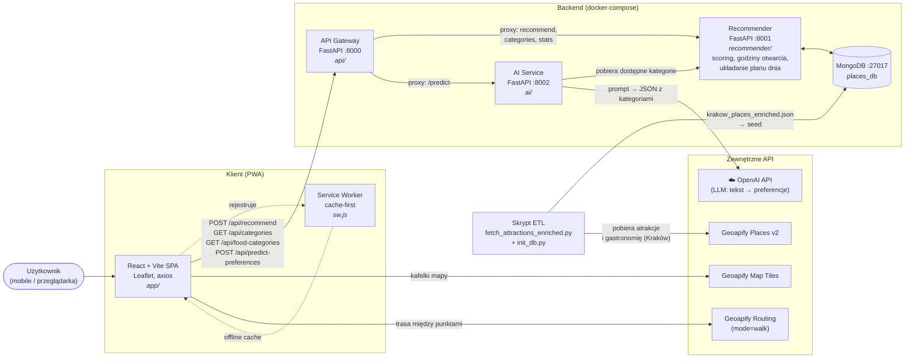

# Planer zwiedzania Krakowa (PWA)

**Skład grupy:** Dawid Zawiślak, Piotr Rusak, Paweł Prus

## Opis projektu

Aplikacja PWA (instalowana na telefonie lub komputerze), która na podstawie preferencji użytkownika układa plan zwiedzania Krakowa na kilka dni.

Użytkownik:

1. zaznacza na mapie **punkt bazowy** (np. hotel), z którego wyrusza każdego dnia,
2. dla każdego dnia wybiera **godziny zwiedzania** i **posiłki** (śniadanie, obiad, kolacja),
3. podaje, **co lubi zwiedzać** i **jaką kuchnię preferuje**. Może to opisać zwykłym tekstem, a model językowy (LLM) zamieni opis na kategorie miejsc.

W odpowiedzi dostaje **harmonogram każdego dnia** z atrakcjami i restauracjami oraz **trasę na mapie**. Przy wyborze miejsc system bierze pod uwagę ich popularność, odległość i godziny otwarcia.

Docelowo aplikacja będzie wdrożona w chmurze i dostępna publicznie.

## Stos technologiczny

| Warstwa | Technologie |
|---|---|
| Frontend (PWA) | React, TypeScript, Vite, Tailwind CSS, Leaflet, axios, Service Worker |
| Backend | FastAPI (Python): API Gateway i silnik rekomendacji |
| Moduł AI | FastAPI + OpenAI API: zamiana opisu preferencji na kategorie |
| Baza danych | MongoDB |
| Usługi zewnętrzne | Geoapify: kafelki mapy, routing pieszy, Places API (źródło danych o miejscach) |
| Uruchamianie | Docker / docker-compose (każdy moduł w osobnym kontenerze) |

## Architektura



### Moduły

- **`app/`**: frontend PWA (React + Vite + Tailwind). Formularz preferencji, wybór punktu bazowego na mapie, widok harmonogramu i trasy. Service Worker cache'uje zasoby aplikacji, dzięki czemu działa ona także offline.
- **`api/`**: API Gateway (FastAPI, port 8000). Jedyny punkt wejścia dla frontendu: przekazuje żądania do Recommendera i AI Service.
- **`recommender/`**: silnik rekomendacji (FastAPI, port 8001). Ocenia miejsca (popularność, odległość, godziny otwarcia), układa plan każdego dnia i udostępnia listy kategorii.
- **`ai/`**: AI Service (FastAPI, port 8002). Pobiera listę dostępnych kategorii z Recommendera, buduje prompt do OpenAI API i zwraca kategorie atrakcji oraz kuchni w formacie JSON.
- **MongoDB** (port 27017, baza `places_db`): atrakcje i lokale gastronomiczne Krakowa.
- **Skrypt ETL**:  pobiera dane z Geoapify Places i zapisuje je do pliku JSON, a następnie zasila nimi bazę.

### Endpointy API Gateway

| Metoda | Ścieżka | Opis |
|---|---|---|
| `POST` | `/api/recommend` | Generuje plan zwiedzania na podstawie preferencji |
| `GET` | `/api/categories` | Lista kategorii atrakcji |
| `GET` | `/api/food-categories` | Lista kategorii kuchni |
| `POST` | `/api/predict-preferences` | Zamienia opis tekstowy na kategorie (LLM) |

## Wysokopozioma struktura repozytorium

```
.
├── ai/                                 # AI Service (FastAPI :8002)
├── api/                                # API Gateway (FastAPI :8000)
├── app/                                # Frontend PWA (React + TypeScript + Vite + Tailwind)
├── recommender/                        # Silnik rekomendacji (FastAPI :8001)
├── docker-compose.yml
└── README.md
```

## Zadania

### 1. Przygotowanie backendu

**Dane i baza**
- [ ] Pobranie atrakcji i gastronomii Krakowa z Geoapify Places v2 (współrzędne, kategorie, godziny otwarcia, popularność)
- [ ] Ujednolicenie kategorii atrakcji i kuchni (słownik kategorii)
- [ ] Zasilenie MongoDB i utworzenie indeksów (m.in. indeks geoprzestrzenny `2dsphere`)

**Recommender (`recommender/`)**
- [ ] Endpointy `GET /categories`, `GET /food-categories`, `GET /stats`
- [ ] Parsowanie godzin otwarcia i sprawdzanie, czy miejsce jest otwarte w danym dniu i przedziale czasowym
- [ ] Ocena miejsca (popularność, odległość od punktu bazowego / poprzedniego punktu, dopasowanie do kategorii)
- [ ] Układanie planu dnia (kolejność atrakcji, posiłki w odpowiednich porach, powrót do punktu bazowego, brak powtórzeń między dniami)
- [ ] Plan na wiele dni (harmonogram + współrzędne do trasy)

**AI Service (`ai/`)**
- [ ] Klient OpenAI API (klucz i model konfigurowane przez zmienne środowiskowe)
- [ ] Prompt z listą dostępnych kategorii (pobieranych z Recommendera) i wymuszeniem odpowiedzi w formacie JSON
- [ ] Walidacja odpowiedzi: odrzucenie kategorii spoza słownika, obsługa błędów i timeoutów
- [ ] Endpoint `POST /predict`

**API Gateway (`api/`)**
- [ ] Proxy do Recommendera i AI Service (`/api/recommend`, `/api/categories`, `/api/food-categories`, `/api/predict-preferences`)
- [ ] Walidacja danych wejściowych, konfiguracja CORS, obsługa błędów usług wewnętrznych
- [ ] Dokumentacja OpenAPI (Swagger)

**Wspólne**
- [ ] Dockerfile dla każdej usługi + `docker-compose.yml` (sieć wewnętrzna, wolumen dla MongoDB)
- [ ] Testy jednostkowe scoringu, planera i parsera godzin otwarcia (pytest)

### 2. Przygotowanie frontendu

- [ ] Konfiguracja projektu (Vite, Tailwind, ESLint), klient API
- [ ] Komponenty wspólne i zasoby współdzielone
- [ ] Stan planu w aplikacji za pomocą kontekstu
- [ ] `Home` / `HomePage`: ekran startowy
- [ ] `Map`: mapa Leaflet z kafelkami Geoapify, wybór punktu bazowego kliknięciem
- [ ] `NewDay` + `DaySelector`: dodawanie dni, godziny zwiedzania, wybór posiłków (śniadanie / obiad / kolacja)
- [ ] `ChooseCategories`: wybór kategorii atrakcji i kuchni (z `/api/categories`, `/api/food-categories`) oraz pole tekstowe → `/api/predict-preferences` → automatyczne zaznaczenie kategorii (z możliwością korekty)
- [ ] Zbudowanie żądania `/api/recommend` ze stanu aplikacji
- [ ] `Plan` / `Schedule` + `PlanDayCard`, `TimelineItem`: harmonogram każdego dnia (godziny, atrakcje, restauracje)
- [ ] `MapComponent`: trasa piesza na mapie (Geoapify Routing, `mode=walk`) z podziałem na dni, szczegóły miejsca po kliknięciu znacznika
- [ ] Responsywny interfejs (mobile-first), stany ładowania i obsługa błędów (`AlertMessage`)
- [ ] Zapisywanie ostatniego planu lokalnie (dostępny bez sieci)

### 3. Deployment i konfiguracja PWA

**PWA**
- [ ] `public/manifest.json`: nazwa, ikony w wymaganych rozmiarach, `display: standalone`, kolory motywu
- [ ] `public/sw.js`: cache-first dla zasobów statycznych, strategia dla kafelków mapy i odpowiedzi API
- [ ] Rejestracja Service Workera i obsługa aktualizacji wersji
- [ ] Weryfikacja instalowalności i działania offline (Lighthouse) na telefonie i komputerze

**Deployment**
- [ ] Produkcyjny build frontendu serwowany przez nginx (kontener), reverse proxy `/api` → API Gateway
- [ ] Wybór i konfiguracja chmury (VM z docker-compose lub usługa kontenerowa), MongoDB (kontener z wolumenem lub MongoDB Atlas)
- [ ] Domena i HTTPS (wymagane przez PWA i Service Workera), np. Let's Encrypt
- [ ] Zarządzanie sekretami (klucze OpenAI i Geoapify) poza repozytorium
- [ ] CI/CD (np. GitHub Actions): testy, budowanie obrazów, wdrożenie **
- [ ] Podstawowe logowanie i monitoring usług **
